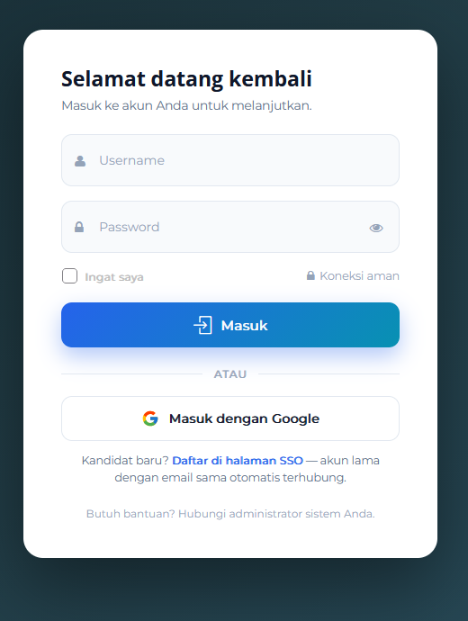
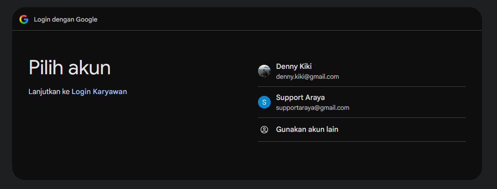
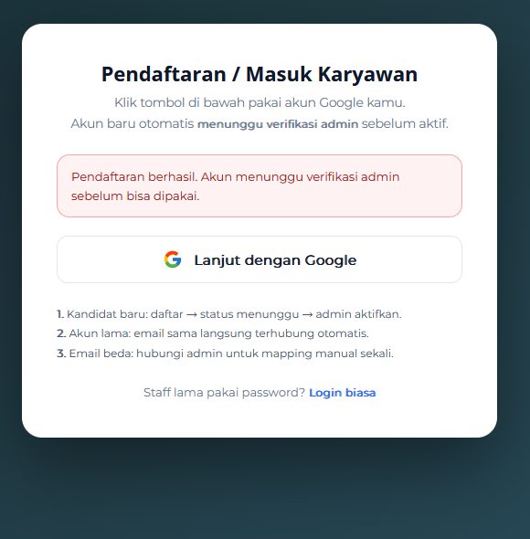
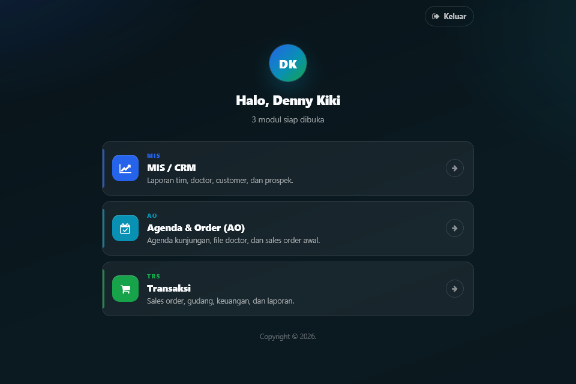
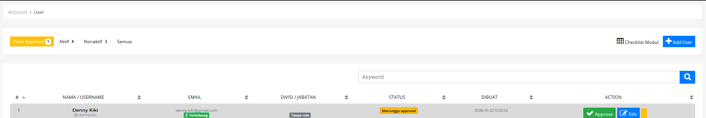
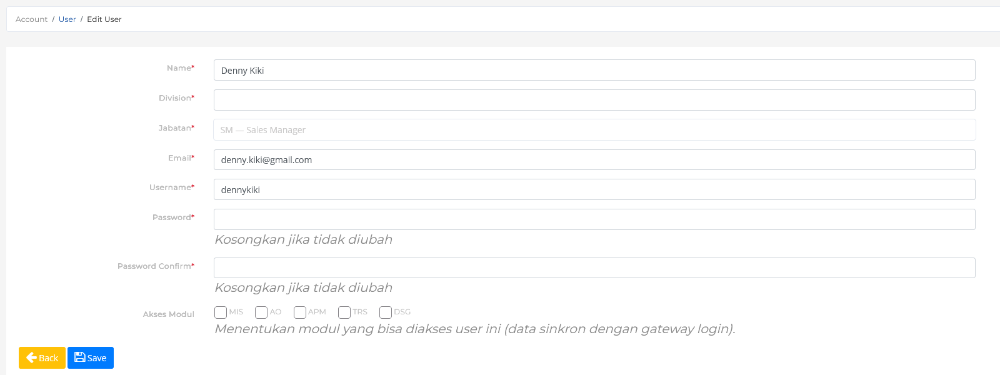
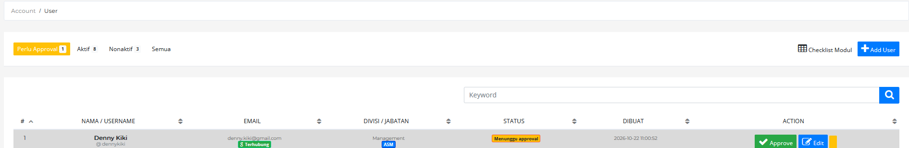
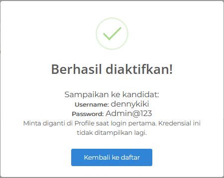

# Panduan Pendaftaran, Verifikasi, dan Login

**Portal Modul PPI**  
Versi 1.0 · 22 Oktober 2026

> Dokumen ini menjelaskan alur pendaftaran kandidat baru melalui Google, verifikasi oleh administrator, serta cara login dan memilih modul. Bagian A untuk kandidat/user, Bagian B untuk administrator.

## Ringkasan alur

| Tahap | Pelaku | Yang dilakukan |
|---|---|---|
| 1 | Kandidat | Membuka halaman login dan memilih **Masuk dengan Google**. |
| 2 | Kandidat | Memilih akun Google yang akan digunakan. |
| 3 | Sistem | Membuat akun baru dengan status **Menunggu approval**. |
| 4 | Administrator | Membuka **Account → User → Perlu Approval**, lalu klik **Edit**. |
| 5 | Administrator | Melengkapi divisi, jabatan, username, password, dan akses modul. |
| 6 | Administrator | Mengklik **Approve** dan mengaktifkan akun. |
| 7 | Administrator | Menyampaikan username dan password awal kepada kandidat. |
| 8 | Kandidat | Login kembali, lalu memilih modul di portal. |

---

## Bagian A — Kandidat / User

### A.1 Pendaftaran akun baru

1. Buka halaman login portal di `https://trans.lssoft88.xyz/auth/superuser/`.
2. Klik tombol **Masuk dengan Google**.

   

   *Gambar 1 — Halaman login. Kandidat baru dapat langsung memilih Masuk dengan Google.*

3. Pilih akun Google yang akan didaftarkan.

   

   *Gambar 2 — Jika ada lebih dari satu akun, pilih salah satu. Jika hanya satu akun, Google langsung menampilkan verifikasi.*

4. Jika akun belum pernah terdaftar, sistem akan menampilkan pesan berikut.

   

   *Gambar 3 — Pendaftaran berhasil, akun menunggu verifikasi administrator.*

**Hal penting saat mendaftar:**

- Gunakan email dengan domain `gmail.com`.
- Jika email sudah terdaftar dan belum terhubung ke Google, sistem akan menautkan akun lama secara otomatis.
- Jika email Google berbeda dengan email akun lama, hubungi administrator untuk proses penautan manual.
- Cukup daftar satu kali. Pendaftaran ulang dengan email berbeda akan menyulitkan proses verifikasi.

### A.2 Menunggu verifikasi

Setelah pendaftaran berhasil, akun **belum aktif**. Administrator akan memeriksa pengajuan dan melengkapi data kandidat.

- Status akun di sistem administrator adalah **Menunggu approval**.
- Jika kandidat mencoba login sebelum diaktifkan, sistem menampilkan pesan **“Akun belum aktif. Hubungi admin untuk verifikasi.”**
- Kandidat tidak perlu mendaftar ulang; cukup tunggu konfirmasi administrator.

### A.3 Menerima kredensial

Setelah akun diaktifkan, administrator akan mengirimkan:

- **Username**
- **Password awal**

Password awal bersifat sementara. Segera ganti password melalui menu **Profile** setelah login pertama. Jangan membagikan password kepada orang lain.

### A.4 Login

Kandidat dapat login dengan dua cara.

**Cara 1 — Google (disarankan)**

1. Buka halaman login di `https://trans.lssoft88.xyz/auth/superuser/`.
2. Klik **Masuk dengan Google**.
3. Pilih akun Google yang sama dengan saat pendaftaran.
4. Setelah berhasil, sistem langsung mengarahkan ke portal modul.

**Cara 2 — Username dan password**

1. Buka halaman login di `https://trans.lssoft88.xyz/auth/superuser/`.
2. Isi **Username** dan **Password** yang diberikan administrator.
3. Centang **Ingat saya** bila menggunakan perangkat pribadi.
4. Klik **Masuk**.

Jika password lupa atau tidak berfungsi, hubungi administrator. Administrator dapat mengatur ulang password melalui menu **Edit User**.

### A.5 Memilih modul

Setelah login, kandidat akan diarahkan ke portal sesuai hak aksesnya.

*Gambar 4 — Portal gateway menampilkan modul yang dapat dibuka oleh user.*

- Jika user hanya memiliki **satu modul**, sistem langsung membuka modul tersebut.
- Jika user memiliki **lebih dari satu modul**, portal menampilkan daftar modul. Klik salah satu kartu untuk masuk.
- Jika user **belum memiliki modul**, sistem menampilkan pesan untuk menghubungi administrator.
- Klik **Keluar** di kanan atas untuk logout.

---

## Bagian B — Administrator / Operator

### B.1 Membuka pengajuan kandidat

1. Login sebagai administrator.
2. Buka menu **Account → User**.
3. Pilih tab **Perlu Approval**.

   

   *Gambar 5 — Daftar kandidat yang menunggu approval.*

Kolom yang perlu diperhatikan:

- **Nama / Username** — identitas kandidat.
- **Email** — badge **Terhubung** berarti akun sudah terhubung dengan Google.
- **Divisi / Jabatan** — awalnya **Tanpa role** dan modul default.
- **Status** — **Menunggu approval**.
- **Action** — tombol **Approve**, **Edit**, dan tombol nonaktifkan.

Gunakan kolom **Keyword** untuk mencari nama, username, atau email bila daftar pengajuan banyak.

### B.2 Melengkapi data kandidat

1. Klik **Edit** pada baris kandidat.
2. Lengkapi data berikut.

   

   *Gambar 6 — Form Edit User untuk melengkapi data dan hak akses kandidat.*

   - **Name** — sesuaikan dengan nama kandidat.
   - **Division** — wajib diisi, misalnya `Marketing` atau `Management`.
   - **Jabatan** — pilih **SM — Sales Manager** atau **ASM — Ass Sales Manager**.
   - **Email** — biasanya sudah terisi dari akun Google.
   - **Username** — wajib unik dan mudah diingat kandidat.
   - **Password** dan **Password Confirm** — isi password awal 8–16 karakter. Kosongkan hanya jika tidak ingin mengubah password.
   - **Akses Modul** — centang modul yang boleh digunakan: `MIS`, `AO`, `APM`, `TRS`, `DSG`.

3. Klik **Save**.
4. Kembali ke daftar user dan pastikan divisi, jabatan, serta modul sudah tampil.

   

   *Gambar 7 — Data kandidat setelah dilengkapi; status masih Menunggu approval.*

**Catatan:**

- **Jabatan** menentukan role dan paket menu default kandidat.
- **Akses Modul** menentukan modul yang muncul di portal setelah login.
- Jika tidak ada modul yang dicentang, kandidat tidak dapat membuka modul apa pun.
- Rincian checklist menu per fitur untuk sementara disembunyikan; pengaturan akses dilakukan melalui modul.

### B.3 Approve dan menyampaikan kredensial

1. Pastikan password sudah diisi pada langkah **Edit**. Tombol **Approve** tidak dapat dilanjutkan jika password belum diset.
2. Klik **Approve** pada baris kandidat.
3. Periksa kembali data pada halaman konfirmasi:
   - Nama dan username
   - Password awal (wajib, 8–16 karakter)
   - Jabatan
   - Divisi dan cabang
   - Akses modul
4. Klik **Aktifkan + Terapkan Paket**.
5. Konfirmasi aktivasi.

   

   *Gambar 8 — Kredensial ditampilkan satu kali setelah akun berhasil diaktifkan.*

6. Catat dan kirimkan **Username** dan **Password** kepada kandidat melalui WhatsApp atau email.
7. Klik **Kembali ke daftar**. Kandidat akan masuk ke tab **Aktif**.

**Penting:**

- Password pada halaman approve **wajib diisi**. Jika password sudah diisi pada langkah Edit, gunakan password yang sama agar kredensial yang ditampilkan konsisten.
- Kredensial hanya ditampilkan **satu kali**. Jika lupa, administrator harus mengatur ulang password melalui **Edit User**.
- Jangan mengirim kredensial melalui grup atau kanal publik.

### B.4 Setelah aktivasi

1. Kandidat login kembali melalui **Masuk dengan Google** atau username/password.
2. Portal akan menampilkan modul sesuai **Akses Modul** yang dicentang.
3. Jika kandidat melaporkan akun masih belum aktif, periksa tab **Aktif** dan pastikan statusnya sudah aktif.
4. Jika kandidat tidak melihat modul yang seharusnya, periksa kembali **Edit → Akses Modul**, lalu minta kandidat logout dan login ulang.

### B.5 Perubahan data, reset password, dan penonaktifan

- **Ubah data** — buka **Account → User → Edit**, ubah data yang diperlukan, lalu klik **Save**.
- **Reset password** — isi **Password** dan **Password Confirm** dengan password baru 8–16 karakter, lalu simpan. Jika password dikosongkan, password lama tetap digunakan.
- **Nonaktifkan user** — klik tombol merah (ikon tempat sampah) pada kolom Action.
- **Aktifkan kembali** — pada tab **Nonaktif**, klik tombol kuning (ikon reload).
- Setelah jabatan atau akses modul diubah, minta user logout dan login kembali agar hak akses terbaru diterapkan.

---

## Troubleshooting

| Masalah | Penyebab | Tindakan |
|---|---|---|
| Muncul pesan “Email … tidak diizinkan” | Domain email bukan `gmail.com`. | Gunakan akun Gmail (`gmail.com`). |
| Muncul pesan “Akun belum aktif” | Akun masih menunggu approval. | Administrator memeriksa tab **Perlu Approval** dan mengaktifkan akun. |
| Pendaftaran berhasil tetapi kredensial belum diterima | Akun belum di-approve atau kredensial belum dikirim. | Hubungi administrator; jangan mendaftar ulang. |
| Muncul “Akun Anda belum memiliki akses modul” | Tidak ada modul yang dicentang pada user. | Administrator membuka **Edit → Akses Modul** dan mencentang modul. |
| Login Google gagal | Akun Google tidak membagikan email atau sesi Google bermasalah. | Coba lagi, pastikan izin email diberikan, lalu hubungi administrator. |
| Password salah atau lupa | Password telah diubah atau kredensial salah catat. | Administrator melakukan reset melalui **Edit User**. |
| Tombol Approve tidak bisa digunakan | Password belum diset. | Isi password melalui **Edit User** terlebih dahulu. |
| User tidak bisa membuka modul tertentu | Modul belum dicentang atau user belum login ulang. | Periksa akses modul, lalu minta user logout dan login kembali. |

---

## Keamanan akun

- Gunakan password 8–16 karakter dan kombinasi huruf serta angka.
- Ganti password awal segera setelah login pertama.
- Jangan membagikan password kepada rekan kerja atau pihak lain.
- Selalu klik **Keluar** setelah menggunakan perangkat bersama.
- Administrator tidak dapat melihat password lama. Jika password hilang, lakukan reset melalui **Edit User**.

---

## Lampiran

### Daftar modul

| Kode | Nama | Fungsi |
|---|---|---|
| `MIS` | MIS / CRM | Laporan tim, doctor, customer, dan prospek. |
| `AO` | Agenda & Order | Agenda kunjungan, file doctor, dan sales order awal. |
| `APM` | APM | Modul APM. |
| `TRS` | Transaksi | Sales order, gudang, keuangan, dan laporan. |
| `DSG` | Design | Design drive dan aset produk. |

### Domain email yang diizinkan

`gmail.com`

### Status user

| Status | Arti |
|---|---|
| Menunggu approval | Akun sudah terdaftar tetapi belum bisa digunakan. |
| Aktif | Akun sudah diaktifkan dan dapat login. |
| Nonaktif | Akun dinonaktifkan sementara dan tidak dapat login. |
